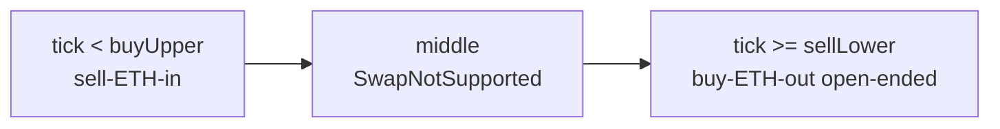
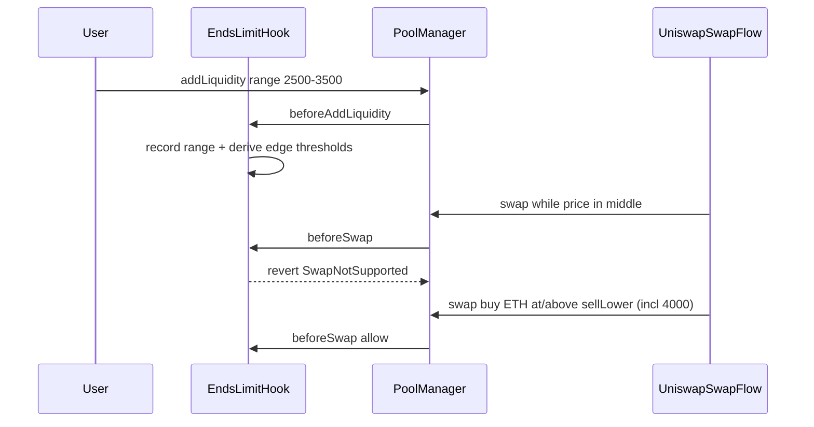

# EndsLimitHook 流动性玩法（beforeSwap 门控版）

用户第一次 `addLiquidity` 的 range（如 `[2500, 3500]`）被 hook 记下；`edgeBps`（如 2%）在构造时固定。  
Hook **不代挂仓**；中间 `beforeSwap` 拒绝；两端开门外放行。成交来自 Uniswap swap 流量。

## 区间怎么切

Range 来自首次加仓的 `[tickLower, tickUpper]`，`edgeBps = 200`：

| 区域 | 价格带（例） | 行为 |
|---|---|---|
| 低端（开门外） | `tick < buyUpper`（≈ `<2500`，含 ~2450 买边） | 只允许「卖 ETH 进池」 |
| 中间 | `[buyUpper, sellLower)`（≈ `[2500, 3430)`） | `SwapNotSupported` |
| 高端（开门外） | `tick >= sellLower`（≈ `≥3430`，**含 4000+**） | 只允许「买 ETH 出池」 |

## 生命周期

## 明确不做

- 不提供 `configureRange` / `placeBuy` / `placeSell`
- 不在 `afterSwap` 动态插撤流动性
- hook 不主动发起 swap
