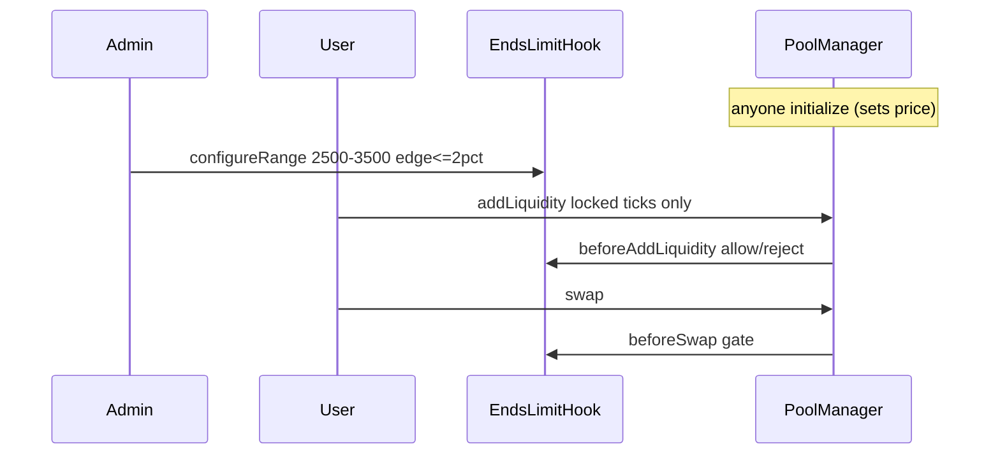

# EndsLimitHook 流动性玩法（管理员锁定 range）

每个池由管理员配置一套 range（如 ETH/USDT `[2500, 3500]`）。同池所有 LP 必须使用该 ticks；不同交易对是不同池。

## 规则摘要

| 项 | 行为 |
|---|---|
| 配置 | 仅管理员 `configureRange`；edge ≤2%；宽度 ≥5%；每池一次 |
| 初始价 | 第一个 `initialize` 的人 |
| 加仓 | 任何人；ticks 必须等于锁定 range |
| swap | 任何人；中间拒单；两端开门外按方向放行 |

